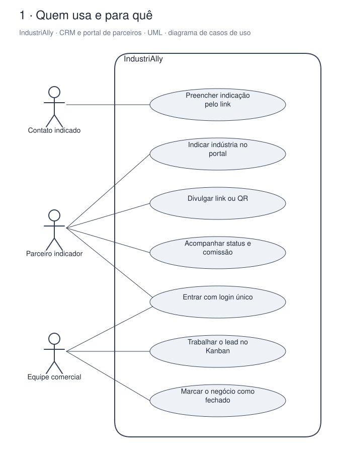
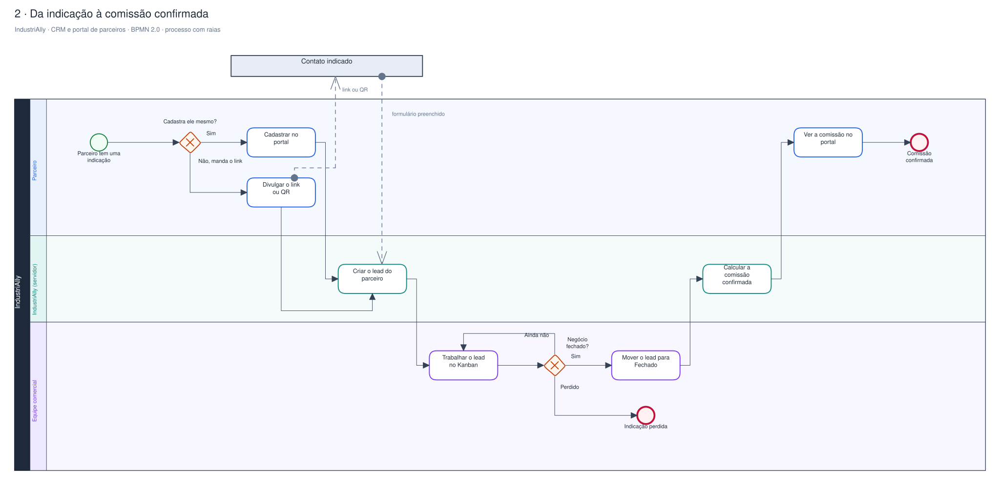
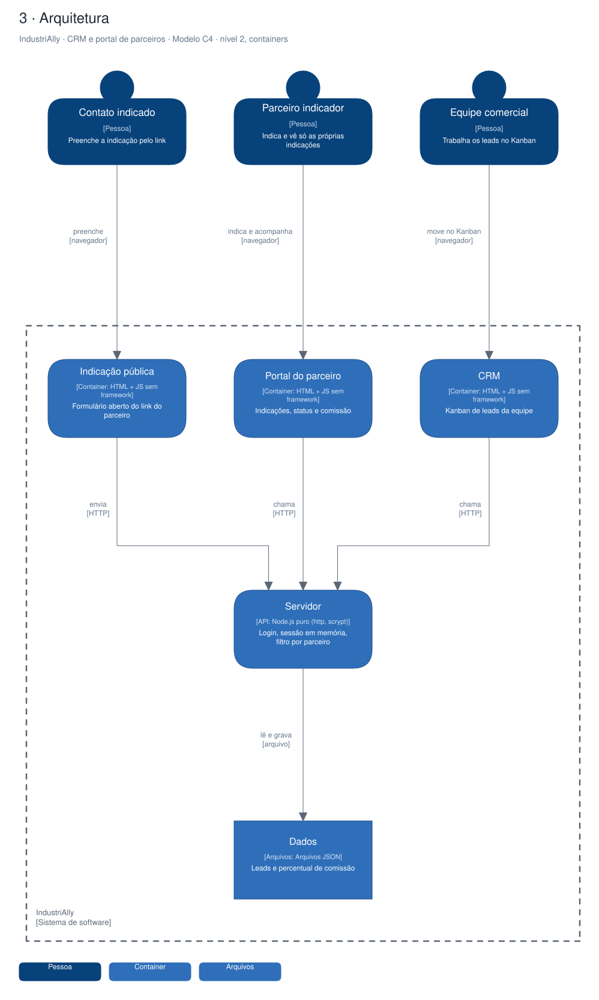

# Arquitetura

Diagramas gerados a partir do Sinapse (o segundo cérebro do Pedro). Cada projeto tem três vistas,
cada uma numa notação padrão:

1. **Quem usa e para quê**: UML, diagrama de casos de uso.
2. **O processo principal**: BPMN 2.0, com raias por quem executa.
3. **A arquitetura**: modelo C4, nível 2 (containers).

## IndustriAlly · CRM e portal de parceiros

Plataforma única da Celiware (um domínio, um login) que junta o CRM interno da equipe e o portal onde parceiros indicam indústrias e acompanham a comissão. Node puro, sem dependências, dados em JSON. Arquivada; serviu de base ao Expert Work.

### Quem usa e para quê (UML)

### Da indicação à comissão confirmada (BPMN 2.0)

### Arquitetura (C4, containers)

Editável: [`industrially.excalidraw`](./industrially.excalidraw), abre em [excalidraw.com](https://excalidraw.com) ou no VS Code com a extensão Excalidraw.

A fonte destes arquivos é o vault do Sinapse (`09-DESENHOS/`); alterações feitas aqui são sobrescritas na próxima publicação.
